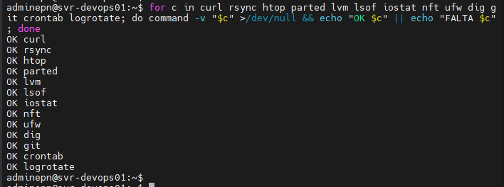
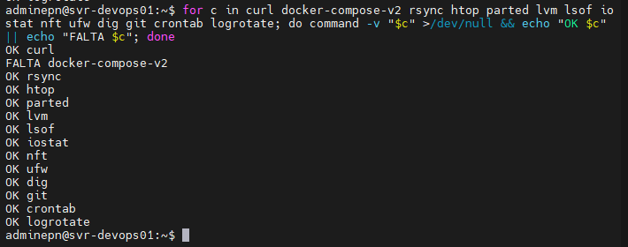

# Laboratorio 2 - Utilitarios

## Instalación de herramientas básicas

<p style="text-align: justify;">
Ejecutamos el siguiente comando 
</p>

```bash
sudo apt install -y openssh-server acl tree etckeeper
```

<p style="text-align: justify;">
Este comando instala herramientas esenciales para la administración de Linux:

- **openssh-server:** permite acceder al servidor de forma remota mediante SSH.
- **acl:** permite gestionar permisos de acceso avanzados mediante ACL. Incluye `getfacl` para consultar y `setfacl` para configurar las Listas de Control de Acceso. 
- **tree:** muestra la estructura de directorios en forma de árbol.
- **etckeeper:** permite controlar y registrar cambios realizados en la configuración del directorio /etc.
</p>

## Verificación de herramientas

<p style="text-align: justify;">
Verificamos que diferentes herramientas necesarias para la administración del sistema se encuentren instaladas y disponibles en el sistema.
</p>


```bash
for c in curl rsync htop parted lvm lsof iostat nft ufw dig git crontab logrotate; do command -v "$c" >/dev/null && echo "OK $c" || echo "FALTA $c"; done
```
Este comando recorre la lista de herramientas y utiliza command -v para comprobar si cada comando está disponible.
- OK: el comando está disponible.
- FALTA: el comando no se encuentra instalado o no está disponible en el PATH.

Resultado:

### Resultado esperado

```text
OK curl
OK rsync
OK htop
OK parted
OK lvm
OK lsof
OK iostat
OK nft
OK ufw
OK dig
OK git
OK crontab
OK logrotate
```



```text
OK curl
FALTA docker-compose-v2
OK rsync
OK htop
OK parted
OK lvm
OK lsof
OK iostat
OK nft
OK ufw
OK dig
OK git
OK crontab
OK logrotate
```




