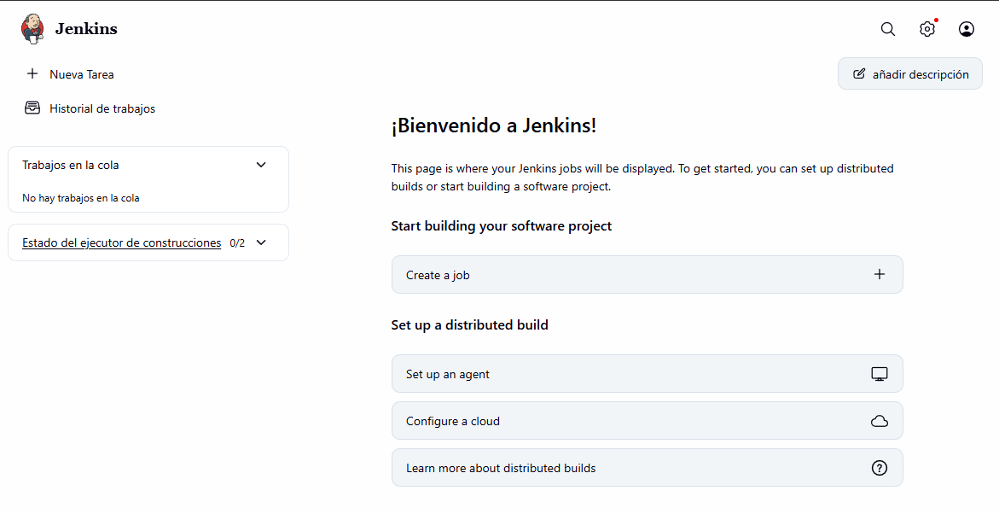
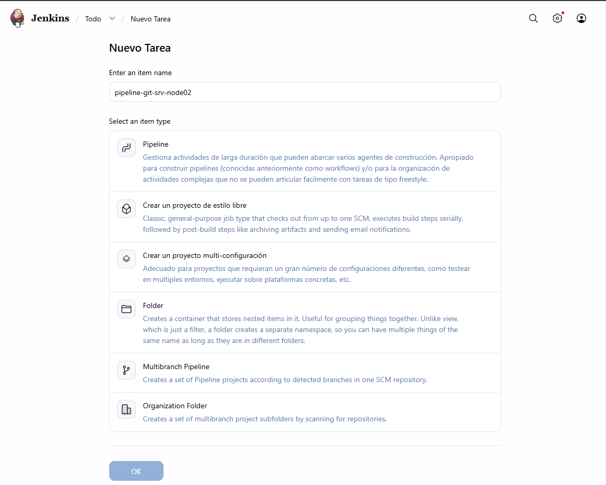
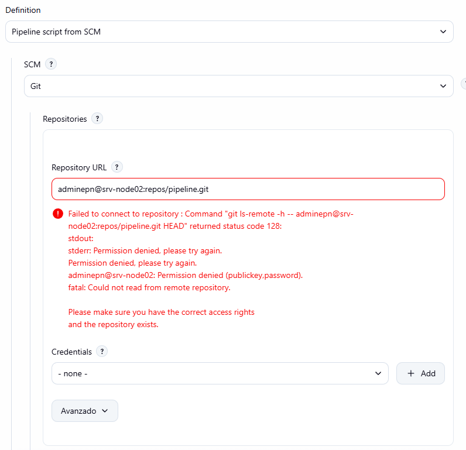
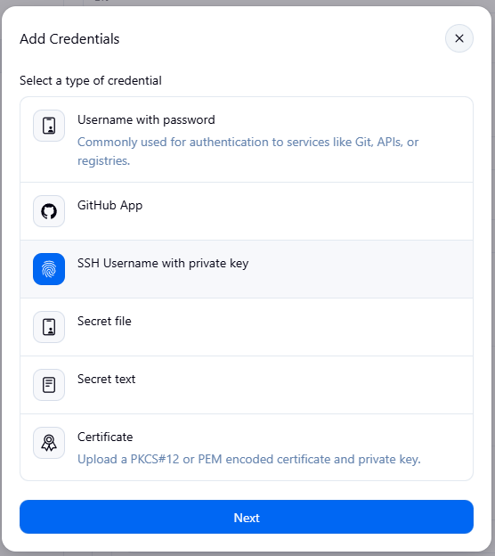
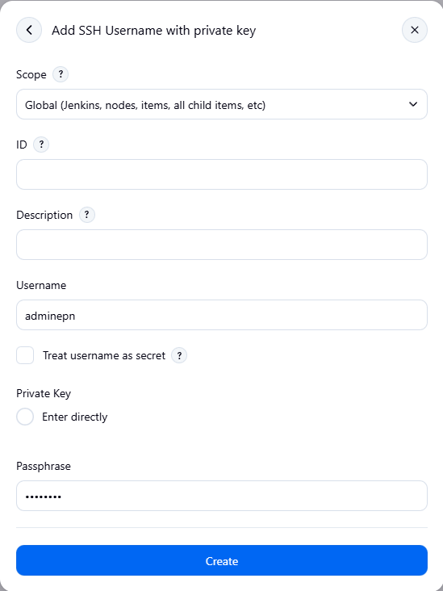
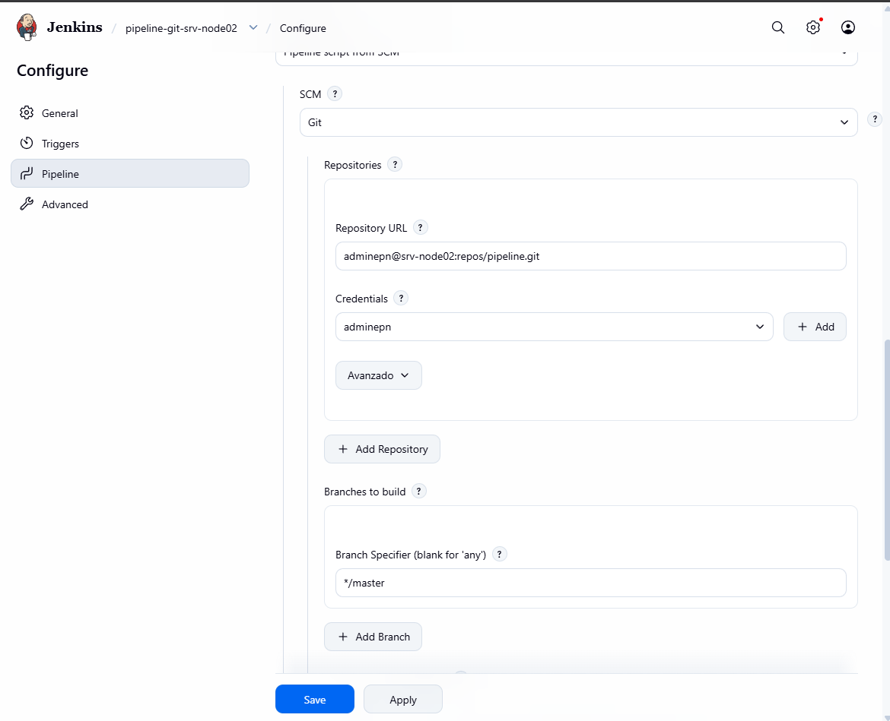
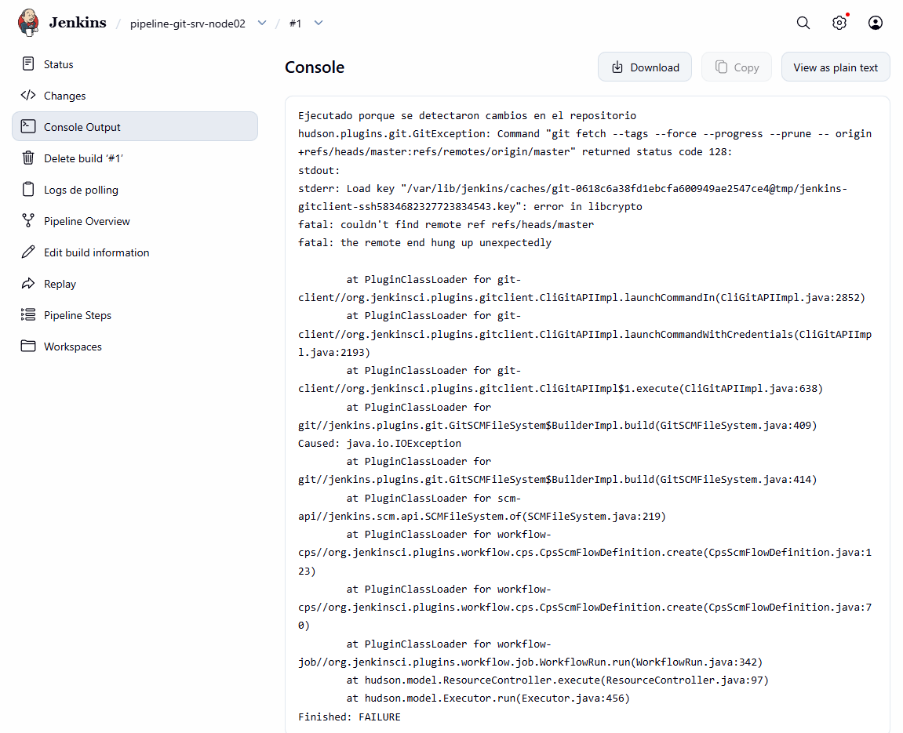
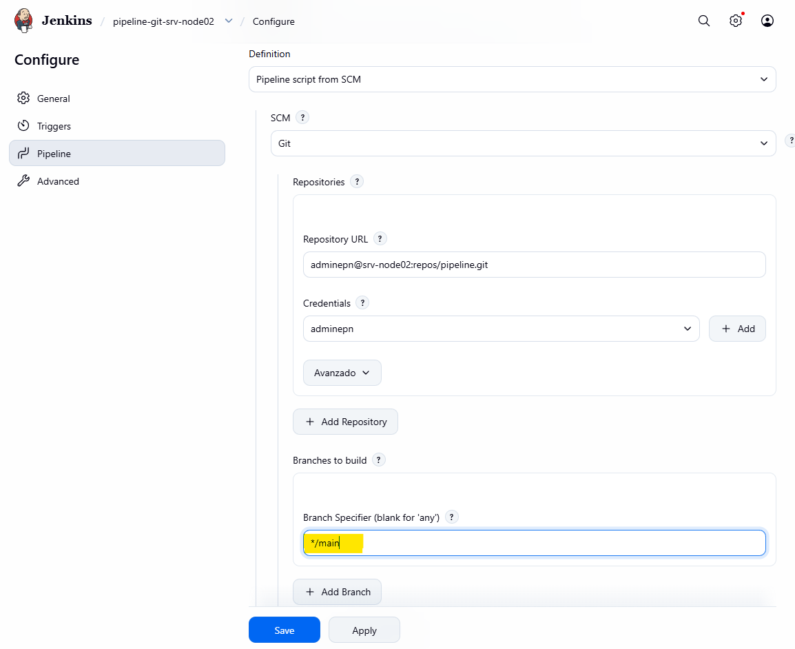
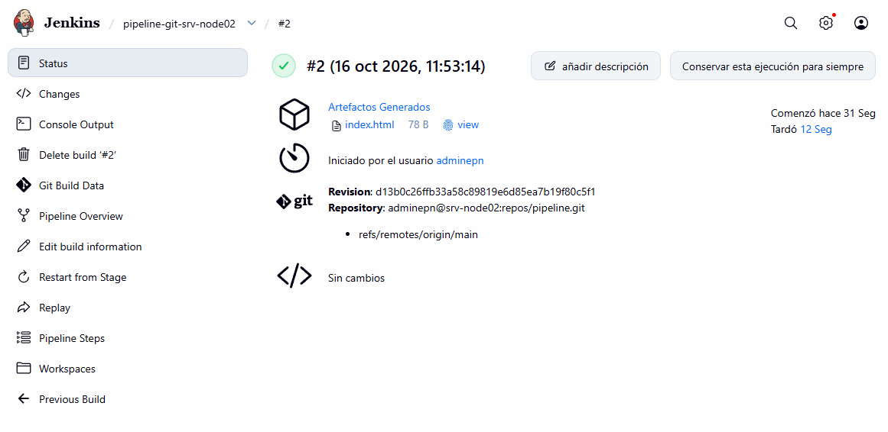

## 

adminepn@svr-devops01:~/unidad3$ ls -la
total 20
drwxrwxr-x 3 adminepn adminepn 4096 Oct 15 22:36 .
drwxr-x--- 8 adminepn adminepn 4096 Oct 15 17:06 ..
-rw-r--r-- 1 root     root       97 Oct 15 16:40 env.sh
-rw-rw-r-- 1 adminepn adminepn  149 Oct 15 22:35 node02_hostkey
drwxrwxr-x 5 adminepn adminepn 4096 Oct 15 21:58 portal
adminepn@svr-devops01:~/unidad3$
adminepn@svr-devops01:~/unidad3$ more env.sh
export NODE_USER="adminepn"
export NODE_HOST="srv-node02"
export LAB_REPO="$HOME/unidad3/portal"
adminepn@svr-devops01:~/unidad3$
adminepn@svr-devops01:~/unidad3$ source "$HOME/unidad3/env.sh"
adminepn@svr-devops01:~/unidad3$

adminepn@svr-devops01:~/unidad3/portal$ tree
.
├── Jenkinsfile
├── tests
│   └── test_content.sh
└── web
└── index.html

3 directories, 3 files
adminepn@svr-devops01:~/unidad3/portal$

adminepn@svr-devops01:~/unidad3/portal$ more tests/test_content.sh
#!/usr/bin/env bash
set -euo pipefail
test -s web/index.html
grep -Fq "Portal Ejemplo" web/index.html
grep -Fq "Version" web/index.html
echo "Pruebas validadas"
adminepn@svr-devops01:~/unidad3/portal$ bash tests/test_content.sh
Pruebas validadas
adminepn@svr-devops01:~/unidad3/portal$

adminepn@svr-devops01:~/unidad3/portal$ git log
commit 1b88af90429c99e59c40d88f6055243b4a820109 (HEAD -> main)
Author: Byron Carpio <byron.carpio@quito.gob.ec>
Date:   Thu Oct 15 22:02:49 2026 -0500

    Agregar Pipeline cI declarativo TEST

commit d06c306d3ab8c4ae7e9d9e65752db04013b0d015 (origin/main)
Author: Byron Carpio <byron.carpio@quito.gob.ec>
Date:   Thu Oct 15 17:05:43 2026 -0500

    Archivos iniciales de Portal Ejemplo EPN

Para cambiar texto 

sed -i "s/Portal Ejemplo/Portal Temporal/" web/index.html

adminepn@svr-devops01:~/unidad3/portal$ git add web/index.html
adminepn@svr-devops01:~/unidad3/portal$ git commit -m "Actualización de web/index.html. Cambio de Título"
On branch main
Your branch is ahead of 'origin/main' by 1 commit.
(use "git push" to publish your local commits)

nothing to commit, working tree clean

# Forzamos un cambio 

adminepn@svr-devops01:~/unidad3/portal$ sudo vim web/index.html

y cambiamos a Portal Ejemplo 

adminepn@svr-devops01:~/unidad3/portal$ more web/index.html
<!doctype html>
<html lang="es">
  <head>
    <meta charset="utf-8"> <title> Portal Ejemplo EPN </title>
  </head>
  <body>
    <h1>Portal de Ejemplo Servicios Munipales</h1> 
Version 1.0

  </body>
</html>

adminepn@svr-devops01:~/unidad3/portal$ git add web/index.html                                adminepn@svr-devops01:~/unidad3/portal$ git commit -m "Actualización de web/index.html. Cambio de Título"
[main bda0636] Actualización de web/index.html. Cambio de Título
1 file changed, 1 insertion(+), 1 deletion(-)
adminepn@svr-devops01:~/unidad3/portal$

adminepn@svr-devops01:~/unidad3/portal$ GIT_SSH_COMMAND="ssh -i $HOME/.ssh/jenkins_git_lab -o IdentitiesOnly=yes" git push -u origin main
Enumerating objects: 10, done.
Counting objects: 100% (10/10), done.
Delta compression using up to 4 threads
Compressing objects: 100% (6/6), done.
Writing objects: 100% (7/7), 899 bytes | 899.00 KiB/s, done.
Total 7 (delta 2), reused 0 (delta 0), pack-reused 0 (from 0)
To ssh://srv-node02/home/adminepn/repos/portal.git
d06c306..bda0636  main -> main
branch 'main' set up to track 'origin/main'.

## Publicación Nueva

Guardar en github un proyecto, para esto se debe tener un jenkins file con todas las instrucciones y un pipeline

# Nodo 1

Revisar versiones 

adminepn@svr-devops01:~/unidad3/portal$ git --version
git version 2.53.0
adminepn@svr-devops01:~/unidad3/portal$
adminepn@svr-devops01:~/unidad3/portal$ bash --version
GNU bash, version 5.3.9(1)-release (x86_64-pc-linux-gnu)
Copyright (C) 2025 Free Software Foundation, Inc.
License GPLv3+: GNU GPL version 3 or later <http://gnu.org/licenses/gpl.html>

This is free software; you are free to change and redistribute it.
There is NO WARRANTY, to the extent permitted by law.

Creamos el proyecto 

adminepn@svr-devops01:~/unidad3$ mkdir pipeline
adminepn@svr-devops01:~/unidad3$ cd pipeline/
adminepn@svr-devops01:~/unidad3/pipeline$ vim index.html

Contenido 

adminepn@svr-devops01:~/unidad3/pipeline$ more index.html
<!DOCTYPE html>
<html>
        <body>
                <h1> Mi pipeline EPN </h1>
        </body>
</html>

adminepn@svr-devops01:~/unidad3/pipeline$ vim Jenkinsfile

adminepn@svr-devops01:~/unidad3/pipeline$ more Jenkinsfile
pipeline {
agent any

    options {
        skipDefaultCheckout(true)
    }

    stages {

        stage('1. Descargar') {
            steps {
                checkout scm
            }
        }

        stage('2. Probar') {
            steps {
                sh 'test -f index.html'
                sh 'grep -q "EPN" index.html'
            }
        }

        stage('3. Preparar') {
            steps {
                sh 'mkdir -p dist'
                sh 'cp index.html dist/'

                archiveArtifacts artifacts: 'dist/index.html'
            }
        }

        stage('4. Publicar') {
            steps {
                sh '''
                    mkdir -p "$HOME/jenkins-epn"
                    cp dist/index.html "$HOME/jenkins-epn/"
                '''
            }
        }
    }

    post {
        success {
            echo 'PIPELINE EPN OK'
        }

        failure {
            echo 'PIPELINE EPN DOWN'
        }
    }
}

Inicializamos el git 

adminepn@svr-devops01:~/unidad3/pipeline$ git init -b main
Initialized empty Git repository in /home/adminepn/unidad3/pipeline/.git/

adminepn@svr-devops01:~/unidad3/pipeline$ git init -b main
Initialized empty Git repository in /home/adminepn/unidad3/pipeline/.git/
adminepn@svr-devops01:~/unidad3/pipeline$ ll
total 20
drwxrwxr-x 3 adminepn adminepn 4096 Oct 16 09:09 ./
drwxrwxr-x 4 adminepn adminepn 4096 Oct 16 08:50 ../
drwxrwxr-x 6 adminepn adminepn 4096 Oct 16 09:15 .git/
-rw-rw-r-- 1 adminepn adminepn  958 Oct 16 09:06 Jenkinsfile
-rw-rw-r-- 1 adminepn adminepn   78 Oct 16 08:53 index.html
adminepn@svr-devops01:~/unidad3/pipeline$
adminepn@svr-devops01:~/unidad3/pipeline$ git add .
adminepn@svr-devops01:~/unidad3/pipeline$
adminepn@svr-devops01:~/unidad3/pipeline$
adminepn@svr-devops01:~/unidad3/pipeline$ git commit -m "Mi primer pipeline EPN"
Author identity unknown

*** Please tell me who you are.

Run

git config --global user.email "you@example.com"
git config --global user.name "Your Name"

to set your account's default identity.
Omit --global to set the identity only in this repository.

fatal: unable to auto-detect email address (got 'adminepn@svr-devops01.(none)')

adminepn@svr-devops01:~/unidad3/pipeline$ git config user.name "Byron Carpio"
adminepn@svr-devops01:~/unidad3/pipeline$ git config user.email "byron.carpio@quito.gob.ec"

adminepn@svr-devops01:~/unidad3/pipeline$ git commit -m "Mi primer pipeline EPN"
[main (root-commit) d13b0c2] Mi primer pipeline EPN
2 files changed, 58 insertions(+)
create mode 100644 Jenkinsfile
create mode 100644 index.html

adminepn@svr-devops01:~/unidad3/pipeline$ git log
commit d13b0c26ffb33a58c89819e6d85ea7b19f80c5f1 (HEAD -> main)
Author: Byron Carpio <byron.carpio@quito.gob.ec>
Date:   Fri Oct 16 09:19:52 2026 -0500

    Mi primer pipeline EPN

### En el servidor 2

adminepn@srv-node02:~$ mkdir -p repos/pipeline.git

adminepn@srv-node02:~$ git init --bare repos/pipeline.git/
hint: Using 'master' as the name for the initial branch. This default branch name
hint: will change to "main" in Git 3.0. To configure the initial branch name
hint: to use in all of your new repositories, which will suppress this warning,
hint: call:
hint:
hint:   git config --global init.defaultBranch <name>
hint:
hint: Names commonly chosen instead of 'master' are 'main', 'trunk' and
hint: 'development'. The just-created branch can be renamed via this command:
hint:
hint:   git branch -m <name>
hint:
hint: Disable this message with "git config set advice.defaultBranchName false"
Initialized empty Git repository in /home/adminepn/repos/pipeline.git/

### configuracion como rama 
sirve para recibir códigos de otros equipos

adminepn@srv-node02:~$ git -C repos/pipeline.git/ symbolic-ref HEAD refs/heads/main

### En el servidor 1

adminepn@svr-devops01:~/unidad3/pipeline$ git remote add origin $NODE_USER@$NODE_HOST:repos/pipeline.git

adminepn@svr-devops01:~/unidad3/pipeline$ git remote -v
origin  adminepn@srv-node02:repos/pipeline.git (fetch)
origin  adminepn@srv-node02:repos/pipeline.git (push)

adminepn@svr-devops01:~/unidad3/pipeline$ git push -u origin main
adminepn@srv-node02's password:
Enumerating objects: 4, done.
Counting objects: 100% (4/4), done.
Delta compression using up to 4 threads
Compressing objects: 100% (4/4), done.
Writing objects: 100% (4/4), 649 bytes | 649.00 KiB/s, done.
Total 4 (delta 0), reused 0 (delta 0), pack-reused 0 (from 0)
To srv-node02:repos/pipeline.git
* [new branch]      main -> main
  branch 'main' set up to track 'origin/main'.

### Configuracion Jenkins 

adminepn@svr-devops01:~/unidad3/pipeline$ hostname
svr-devops01
adminepn@svr-devops01:~/unidad3/pipeline$ sudo systemctl status jenkins --no-pager
● jenkins.service - Jenkins Continuous Integration Server
Loaded: loaded (/usr/lib/systemd/system/jenkins.service; enabled; preset: enabled)
Drop-In: /etc/systemd/system/jenkins.service.d
└─90-java25.conf
Active: active (running) since Thu 2026-10-15 15:07:11 -05; 18h ago
Invocation: 67e11133ed7b45d39cc0bd6718d20c1d
Main PID: 1122 (java)
Tasks: 45 (limit: 6219)
Memory: 914.9M (peak: 950.8M)
CPU: 4min 5.038s
CGroup: /system.slice/jenkins.service
└─1122 /usr/bin/java -Djava.awt.headless=true -jar /usr/share/java/jenkins.war -…

oct 15 15:07:11 svr-devops01 jenkins[1122]: 2026-10-15 20:07:11.226+0000 [id=50]        …ation

adminepn@svr-devops01:~/unidad3/pipeline$ ping srv-node02
PING srv-node02 (172.25.4.81) 56(84) bytes of data.
64 bytes from srv-node02 (172.25.4.81): icmp_seq=1 ttl=64 time=1.05 ms
64 bytes from srv-node02 (172.25.4.81): icmp_seq=2 ttl=64 time=0.760 ms

adminepn@svr-devops01:~/unidad3/pipeline$ sudo -u jenkins git --version
git version 2.53.0

## despliegue 

adminepn@svr-devops01:~/unidad3/pipeline$ git branch --show-current
main

adminepn@svr-devops01:~/unidad3/pipeline$ ls -la
total 20
drwxrwxr-x 3 adminepn adminepn 4096 Oct 16 09:09 .
drwxrwxr-x 4 adminepn adminepn 4096 Oct 16 08:50 ..
drwxrwxr-x 7 adminepn adminepn 4096 Oct 16 09:34 .git
-rw-rw-r-- 1 adminepn adminepn  958 Oct 16 09:06 Jenkinsfile
-rw-rw-r-- 1 adminepn adminepn   78 Oct 16 08:53 index.html

adminepn@svr-devops01:~/unidad3/pipeline$ git ls-remote origin refs/heads/main
adminepn@srv-node02's password:
d13b0c26ffb33a58c89819e6d85ea7b19f80c5f1        refs/heads/main

### Navegador

)

Vamos a generar una nueva tarea

)

Elegimos pipeline -> ok

En la ventada general vamos a llenar con los datos 

)

El error que sale se debe crear las claves privadas

Verificamos 

adminepn@svr-devops01:~/unidad3/pipeline$ git ls-remote -h -- adminepn@srv-node02:repos/pipeline.git
adminepn@srv-node02's password:
d13b0c26ffb33a58c89819e6d85ea7b19f80c5f1        refs/heads/main

adminepn@svr-devops01:~/unidad3/pipeline$ git ls-remote -h -- adminepn@srv-node02:repos/pipeline.git HEAD
adminepn@srv-node02's password:
adminepn@svr-devops01:~/unidad3/pipeline$

adminepn@svr-devops01:~/unidad3/pipeline$ git -C /home/adminepn/unidad3/pipeline/  remote -v
origin  adminepn@srv-node02:repos/pipeline.git (fetch)
origin  adminepn@srv-node02:repos/pipeline.git (push)
adminepn@svr-devops01:~/unidad3/pipeline$

adminepn@svr-devops01:~/unidad3/pipeline$ git ls-remote adminepn@srv-node02:repos/pipeline.git ref/heads/main
adminepn@srv-node02's password:
adminepn@svr-devops01:~/unidad3/pipeline$

adminepn@svr-devops01:~/unidad3/pipeline$ git ls-remote adminepn@srv-node02:repos/pipeline.git ref/heads/main HEAD
adminepn@srv-node02's password:
d13b0c26ffb33a58c89819e6d85ea7b19f80c5f1        HEAD

Servidor 2

adminepn@srv-node02:~$ git -C repos/pipeline.git rev-parse --is-bare-repository
true

Creamos el acceso al nodo 1

adminepn@srv-node02:~$ sudo ssh-keygen -lf /etc/ssh/ssh_host_ed25519_key.pub
256 SHA256:AsqnmV5qx7Epeyg7R5jWqFaPUdPru4HaXYwdJOIpTiw root@srv-node02 (ED25519)

adminepn@svr-devops01:~/unidad3/pipeline$ sudo -u jenkins ssh-keygen \
> -F srv-node02 \
> -f /var/lib/jenkins/.ssh/known_hosts
# Host srv-node02 found: line 2
srv-node02 ssh-ed25519 AAAAC3NzaC1lZDI1NTE5AAAAIG6C88izEO9LbYLhlqrm2RWzxbD5Frnejnr1nwEWNK7i
adminepn@svr-devops01:~/unidad3/pipeline$

regresamos al administrador

seleccionampos add credencials 

)
)

Seleccionamos y ya funciona

)

Verificamos 

Status --> git logs de consultas --> Builds 

luego de la perioricidad se puede validar la ejecucion

)

)

para esto vamos a revisar 

Servidor 1

adminepn@svr-devops01:~/unidad3/pipeline$ git branch --show-current
main

adminepn@svr-devops01:~/unidad3/pipeline$ git ls-remote --heads \
> adminepn@srv-node02:repos/pipeline.git
adminepn@srv-node02's password:
d13b0c26ffb33a58c89819e6d85ea7b19f80c5f1        refs/heads/main
adminepn@svr-devops01:~/unidad3/pipeline$

Nos dice q la ruta es main, pero configuramos como master 

debemos modificar 

)

validarmos 

)

