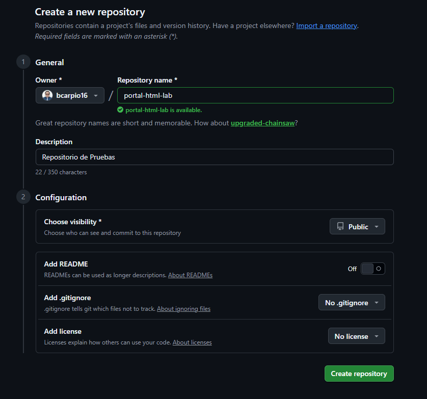
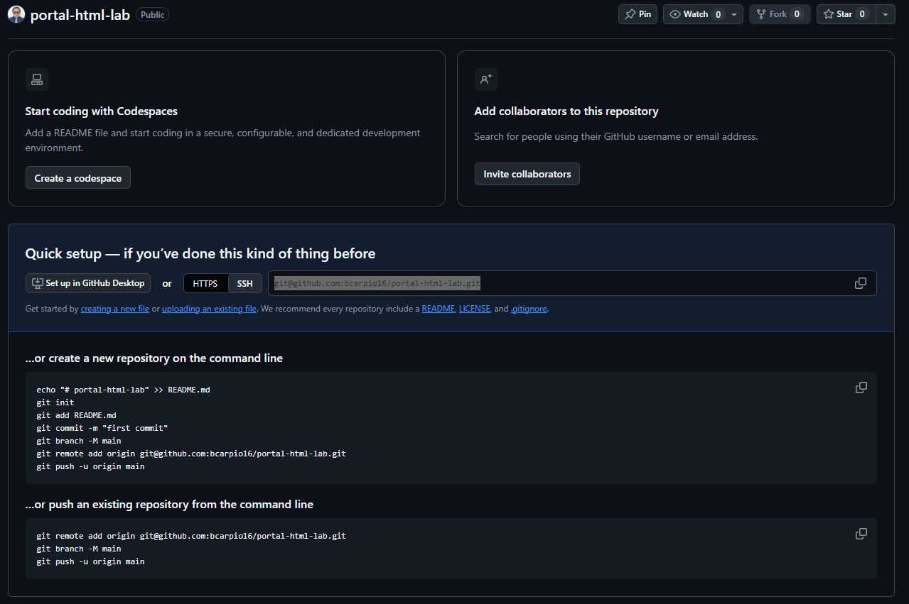
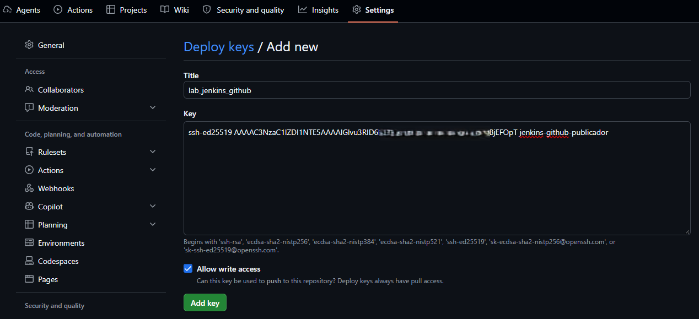
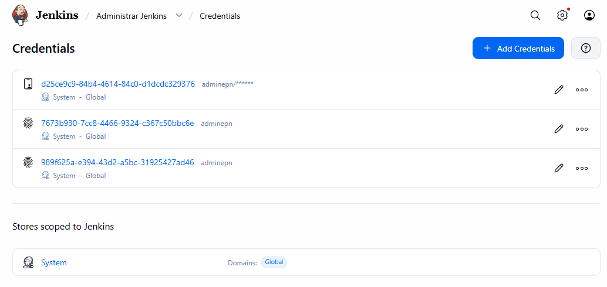
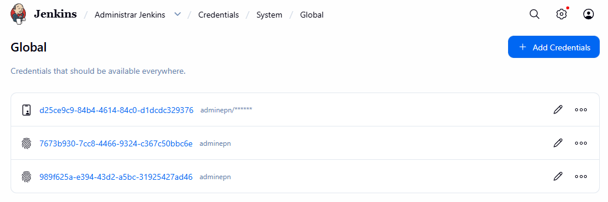
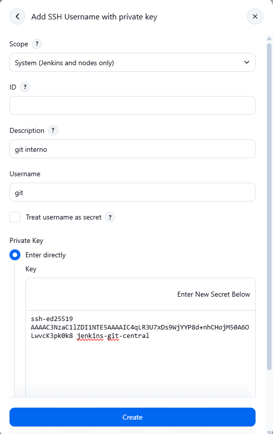

### Lab. Git Central que recibe cambios de desa

NODO 1

adminepn@svr-devops01:~$ hostnamectl --static
svr-devops01

^C
adminepn@svr-devops01:~$ sudo systemctl is-active jenkins
[sudo: authenticate] Password:
active
adminepn@svr-devops01:~$ sudo systemctl status jenkins
● jenkins.service - Jenkins Continuous Integration Server
Loaded: loaded (/usr/lib/systemd/system/jenkins.service; enabled; preset: enabled)
Drop-In: /etc/systemd/system/jenkins.service.d
└─90-java25.conf
Active: active (running) since Mon 2026-10-19 14:21:28 -05; 2h 25min ago
Invocation: 260c934622ab42718e88f8a1d7eaa6d6
Main PID: 1119 (java)
Tasks: 55 (limit: 6219)
Memory: 858.1M (peak: 863.9M)
CPU: 1min 20.412s
CGroup: /system.slice/jenkins.service
└─1119 /usr/bin/java -Djava.awt.headless=true -jar /usr/share/java/jenkins.war --webroot=/var/cache>

oct 19 14:21:27 svr-devops01 jenkins[1119]: 2026-10-19 19:21:27.971+0000 [id=49]        INFO        jenkins.Init>
oct 19 14:21:28 svr-devops01 jenkins[1119]: 2026-10-19 19:21:28.008+0000 [id=53]        INFO        jenkins.Init>
oct 19 14:21:28 svr-devops01 jenkins[1119]: 2026-10-19 19:21:28.050+0000 [id=68]        INFO        hudson.util.>
oct 19 14:21:28 svr-devops01 jenkins[1119]: 2026-10-19 19:21:28.109+0000 [id=45]        INFO        jenkins.Init>
oct 19 14:21:28 svr-devops01 jenkins[1119]: 2026-10-19 19:21:28.182+0000 [id=37]        INFO        hudson.lifec>
oct 19 14:21:28 svr-devops01 systemd[1]: Started jenkins.service - Jenkins Continuous Integration Server.
oct 19 14:21:34 svr-devops01 jenkins[1119]: 2026-10-19 19:21:34.299+0000 [id=68]        INFO        h.m.Download>
oct 19 14:21:35 svr-devops01 jenkins[1119]: 2026-10-19 19:21:35.163+0000 [id=68]        INFO        h.m.Download>
oct 19 14:21:36 svr-devops01 jenkins[1119]: 2026-10-19 19:21:36.056+0000 [id=68]        INFO        h.m.Download>
oct 19 14:21:36 svr-devops01 jenkins[1119]: 2026-10-19 19:21:36.057+0000 [id=68]        INFO        hudson.util.>

adminepn@svr-devops01:~$
adminepn@svr-devops01:~$
adminepn@svr-devops01:~$ sudo -u jenkins git --version
git version 2.53.0

Instalamos en el nodo 01

sudo apt-get install -y openssh-server openssh-client nginx rsync curl

sudo systemctl enable --now ssh

Para verificar que este el servicio 

adminepn@svr-devops01:/$ command -v nginx
/usr/sbin/nginx
adminepn@svr-devops01:/$ command -v curl
/usr/bin/curl

Creamos la cuenta de git restringida en el nodo 1

adminepn@svr-devops01:/$ getent passwd git || sudo useradd -m -s "$(command -v git-shell)" git
git:x:1004:1008::/home/git:/usr/bin/git-shell

adminepn@svr-devops01:/$ sudo usermod -s "$(command -v git-shell)" git
usermod: sin cambios

# Creamos carpeta del directorio para el git

adminepn@svr-devops01:/$ sudo install -d -o git -g git -m 0700 /home/git/.ssh
adminepn@svr-devops01:/$

adminepn@svr-devops01:/$ sudo touch /home/git/.ssh/authorized_keys

adminepn@svr-devops01:/$ sudo chown git:git /home/git/.ssh/authorized_keys
adminepn@svr-devops01:/$ sudo chmod 0600 /home/git/.ssh/authorized_keys

### Limitamos el acceso 

adminepn@svr-devops01:/$ getent passwd git
git:x:1004:1008::/home/git:/usr/bin/git-shell
adminepn@svr-devops01:/$
adminepn@svr-devops01:/$ getent passwd adminepn
adminepn:x:1000:1000:admin:/home/adminepn:/bin/bash
adminepn@svr-devops01:/$

adminepn@svr-devops01:/$ sudo install -d -o git -g git -m 0755 /srv/git

### Inicializamos el proyecto 

adminepn@svr-devops01:/$ sudo -u git git init --bare /srv/git/portal-html.git
Reinitialized existing Git repository in /srv/git/portal-html.git/

adminepn@svr-devops01:/$ sudo -u git git --git-dir=/srv/git/portal-html.git symbolic-ref HEAD refs/head/main

adminepn@svr-devops01:/$ sudo -u git git --git-dir=/srv/git/portal-html.git symbolic-ref HEAD refs/head/main
adminepn@svr-devops01:/$ sudo -u git git --git-dir=/srv/git/portal-html.git symbolic-ref HEAD
refs/head/main

## NODO 02

adminepn@srv-node02:~$ mkdir -p ~/.ssh

adminepn@srv-node02:~$ mkdir 700 ~/.ssh/
mkdir: /home/adminepn/.ssh/: El archivo existe

adminepn@srv-node02:~$ sudo useradd desarrollador
adminepn@srv-node02:~$ passwd desarrollador
passwd: no debe ver o cambiar la información de la contraseña para desarrollador.
adminepn@srv-node02:~$ sudo passwd desarrollador
New password:
Retype new password:
passwd: contraseña actualizada correctamente
adminepn@srv-node02:~$

adminepn@srv-node02:~$ su - desarrollador
Password:
su: warning: cannot change directory to /home/desarrollador: No such file or directory
$

$ pwd
/home/adminepn
$

$ bash
desarrollador@srv-node02:/home/adminepn$

Damos permisos de sudoers

adminepn@srv-node02:~$ sudo vim /etc/sudoers

# User privilege specification
root    ALL=(ALL:ALL) ALL
desarrollador  ALL=(ALL:ALL) ALL

### Dado los permisos creamos la carpeta

adminepn@srv-node02:~$ sudo mkdir -p /home/desarrollador

se puede dar permisos con 

sudo chown desarrollador:desarrollador /home/desarrollador/

o con 

desarrollador@srv-node02:/home/adminepn$ getent passwd desarrollador
desarrollador:x:1002:1002::/home/desarrollador:/bin/sh

adminepn@srv-node02:~$ sudo install -d -o desarrollador -g 1002 -m 0700 /home/desarrollador

sudo -iu desarrollador
$ pwd
/home/desarrollador

$ bash

$ mkdir -p ~/.ssh

desarrollador@srv-node02:~$ chmod 700 ~/.ssh/

desarrollador@srv-node02:~$ ssh-keygen -t ed25519 -f "$HOME/.ssh/id_ed25519_portal" -C "desarrollador@srv-node02"
Generating public/private ed25519 key pair.
Enter passphrase for "/home/desarrollador/.ssh/id_ed25519_portal" (empty for no passphrase):
Enter same passphrase again:
Your identification has been saved in /home/desarrollador/.ssh/id_ed25519_portal
Your public key has been saved in /home/desarrollador/.ssh/id_ed25519_portal.pub
The key fingerprint is:
SHA256:ToxwtC9IUYYi3+DeAXIl+U99dbXkjB/uXOivdB9TGxM desarrollador@srv-node02
The key's randomart image is:
+--[ED25519 256]--+
|  .ooo+        o.|
|o *..+ .    . * .|
| * *o o.   . o E |
|  o.++.+. .   o.o|
| . ..+o S.    .=o|
|  . . .+     .o *|
|        .     o*.|
|             . o+|
|              ..o|
+----[SHA256]-----+

desarrollador@srv-node02:~$ cat "$HOME/.ssh/id_ed25519_portal.pub"
ssh-ed25519 AAAAC3NzaC1lZDI1NTE5AAAAIBzU8oM07kCHwyV2gACqM9umCWNrHNVd5QyANbhQ+D8x desarrollador@srv-node02

### ahora en el nodo 01 

adminepn@svr-devops01:/$ sudo tee -a /home/git/.ssh/authorized_keys > /dev/null << "CLAVE_PUBLICA" ssh-ed25519 AAAAC3NzaC1lZDI1NTE5AAAAIBzU8oM07kCHwyV2gACqM9umCWNrHNVd5QyANbhQ+D8x desarrollador@srv-node02
> CLAVE_PUBLICA

La clave es la obtenida en el nodo2

validamos la clave

adminepn@svr-devops01:/$ sudo ssh-keygen -lf /etc/ssh/ssh_host_ed25519_key.pub -E sha256
256 SHA256:N51UpQMcXpWxlI86TIcpRuCLrjCqcNpPzAxgEwqh854 root@svr-devops01 (ED25519)

adminepn@svr-devops01:/$ sudo ssh-keygen -lf /etc/ssh/ssh_host_ed25519_key.pub -E sha256ssh-keyscan -t ed25519 svr-devops01 | ssh-keygen -lf - -E sha256
256 SHA256:N51UpQMcXpWxlI86TIcpRuCLrjCqcNpPzAxgEwqh854 svr-devops01 (ED25519)

### NODO 2
### creamos la comunicacion

desarrollador@srv-node02:~$ cat >> ~/.ssh/config <<'SSH_CONFIG'
Host svr-devops01
HostName svr-devops01
User git
IdentityFile ~/.ssh/id_ed25519_portal
IdentitiesOnly yes
SSH_CONFIG
desarrollador@srv-node02:~$

desarrollador@srv-node02:~$ chmod 600 ~/.ssh/config

desarrollador@srv-node02:~$ sudo ls -la ~/.ssh/config
[sudo: authenticate] Password:
-rw------- 1 desarrollador desarrollador 110 Oct 20 10:44 /home/desarrollador/.ssh/config

### Realizamos una prueba de conexion 

desarrollador@srv-node02:~$ git clone git@svr-devops01:/srv/git/portal-html.git portal-html
Cloning into 'portal-html'...
warning: You appear to have cloned an empty repository.
hint: Using 'master' as the name for the initial branch. This default branch name
hint: will change to "main" in Git 3.0. To configure the initial branch name
hint: to use in all of your new repositories, which will suppress this warning,
hint: call:
hint:
hint:   git config --global init.defaultBranch <name>
hint:
hint: Names commonly chosen instead of 'master' are 'main', 'trunk' and
hint: 'development'. The just-created branch can be renamed via this command:
hint:
hint:   git branch -m <name>
hint:
hint: Disable this message with "git config set advice.defaultBranchName false"

desarrollador@srv-node02:~$ cd portal-html/
desarrollador@srv-node02:~/portal-html$ git switch -c main
Switched to a new branch 'main'
desarrollador@srv-node02:~/portal-html$
desarrollador@srv-node02:~/portal-html$ git config user.name "Desarrollador DMQ Byron"
desarrollador@srv-node02:~/portal-html$ git config user.email "byron.carpio@quito.gob.ec"
desarrollador@srv-node02:~/portal-html$

desarrollador@srv-node02:~/portal-html$ mkdir -p web
desarrollador@srv-node02:~/portal-html$ cd web/
desarrollador@srv-node02:~/portal-html$ vim index.html

desarrollador@srv-node02:~/portal-html/web$ more index.html
<!DOCTYPE html>
<html lang="es">
<head>
    <meta charset="UTF-8">
    <meta name="viewport" content="width=device-width, initial-scale=1.0">
    <title>Portal HTML - Laboratorio DevOps</title>

    
</head>
<body>

    <header>
        <h1>Portal de Prácticas DevOps</h1>
    </header>

    

        Aplicación utilizada para pruebas de integración continua y despliegue automatizado.
    

    

        <strong>Servidor de Desarrollo:</strong> srv-node02 
        <strong>Servidor DevOps:</strong> svr-devops01
    

    

        <strong>Versión 1.0</strong> - Desplegada mediante Jenkins
    

    <footer>
        Laboratorio DevOps | Git + Jenkins + Nginx
    </footer>

</body>
</html>

#

desarrollador@srv-node02:~/portal-html/web$ printf '# Portal HTML CI/CD\n\nEjercicio de Git, Jenkins y GitHub.\n' > README.md
desarrollador@srv-node02:~/portal-html/web$ git status --short
?? ./

desarrollador@srv-node02:~/portal-html$ git add .
desarrollador@srv-node02:~/portal-html$ git commit -m "feat: crear pagina HTML version 1.0"
[main (root-commit) 419e624] feat: crear pagina HTML version 1.0
2 files changed, 70 insertions(+)
create mode 100644 web/README.md
create mode 100644 web/index.html

desarrollador@srv-node02:~/portal-html$ git push -u origin main
Enumerating objects: 5, done.
Counting objects: 100% (5/5), done.
Delta compression using up to 4 threads
Compressing objects: 100% (4/4), done.
Writing objects: 100% (5/5), 1.02 KiB | 260.00 KiB/s, done.
Total 5 (delta 0), reused 0 (delta 0), pack-reused 0 (from 0)
To svr-devops01:/srv/git/portal-html.git
* [new branch]      main -> main
  branch 'main' set up to track 'origin/main'.

desarrollador@srv-node02:~/portal-html$ git log --oneline -3
419e624 (HEAD -> main, origin/main) feat: crear pagina HTML version 1.0

## Nodo 1

adminepn@svr-devops01:~$ sudo -u git git --git-dir=/srv/git/portal-html.git/ log --oneline --all -3
[sudo: authenticate] Password:
419e624 (main) feat: crear pagina HTML version 1.0
adminepn@svr-devops01:~$

adminepn@svr-devops01:~$ sudo -u git git --git-dir=/srv/git/portal-html.git ls-tree -r --name-only main
web/README.md
web/index.html

adminepn@svr-devops01:~$ sudo -u git git --git-dir=/srv/git/portal-html.git show main:web/index.html | head -n 8
<!DOCTYPE html>
<html lang="es">
<head>
    <meta charset="UTF-8">
    <meta name="viewport" content="width=device-width, initial-scale=1.0">
    <title>Portal HTML - Laboratorio DevOps</title>

    <style>

Hacemos cambios en el header en el nodo 02

<header>
        <h1>Portal de Prácticas DevOps DMQ</h1>
    </header>

desarrollador@srv-node02:~/portal-html/web$ git add .

desarrollador@srv-node02:~/portal-html/web$ git commit -m "update: se actualizo pagina HTML version 1.1"
[main 6ecade6] update: se actualizo pagina HTML version 1.1
1 file changed, 1 insertion(+), 1 deletion(-)
desarrollador@srv-node02:~/portal-html/web$ git push -u origin main                Enumerating objects: 7, done.
Counting objects: 100% (7/7), done.
Delta compression using up to 4 threads
Compressing objects: 100% (3/3), done.
Writing objects: 100% (4/4), 402 bytes | 402.00 KiB/s, done.
Total 4 (delta 1), reused 0 (delta 0), pack-reused 0 (from 0)
To svr-devops01:/srv/git/portal-html.git
419e624..6ecade6  main -> main
branch 'main' set up to track 'origin/main'.
desarrollador@srv-node02:~/portal-html/web$

### Ahora en el nodo 01 Creamos el destino de publicacion
### directorio inmutable

adminepn@svr-devops01:~$ sudo install -d -o jenkins -g jenkins -m 0755 /var/www/portal-html
adminepn@svr-devops01:~$ sudo install -d -o jenkins -g jenkins -m 0755 /var/www/portal-html/releases

### Creamos la configuracion en nginx 

adminepn@svr-devops01:~$ sudo vim /etc/nginx/conf.d/portal-html-lab.conf
adminepn@svr-devops01:~$ more /etc/nginx/conf.d/portal-html-lab.conf
server {
listen 8081;
server_name _;

    root /var/www/portal-html/current;
    index index.html;

    location / {
        try_files $uri $uri/ =404;
    }

    add_header X-Content-Type-Options "nosniff" always;
}

adminepn@svr-devops01:~$ sudo nginx -t
nginx: the configuration file /etc/nginx/nginx.conf syntax is ok
nginx: configuration file /etc/nginx/nginx.conf test is successful

adminepn@svr-devops01:~$ sudo systemctl enable --now nginx
Synchronizing state of nginx.service with SysV service script with /usr/lib/systemd/systemd-sysv-install.
Executing: /usr/lib/systemd/systemd-sysv-install enable nginx

adminepn@svr-devops01:~$ sudo systemctl reload nginx

adminepn@svr-devops01:~$ sudo ss -lntp | grep ':8081'
LISTEN 0      511          0.0.0.0:8081      0.0.0.0:*    users:(("nginx",pid=351143,fd=17),("nginx",pid=351142,fd=17),("nginx",pid=351141,fd=17),("nginx",pid=351139,fd=17),("nginx",pid=1203,fd=17))

adminepn@svr-devops01:~$ ls /var/www/portal-html/
releases

tenemos current se activa cuando supere las validaciones 

## Repositorio remoto en github 
## Todo lo que envia del git de desarrollo (nodo02) al git central (nodo01)
## Como creamos un github q es una replica de la ram, desa ---> nodo 2 y   Jenkins decide cuando hace el commit 

En github

)

SSH 
)

git@github.com:bcarpio16/portal-html-lab.git

### Separamos 2 ssh 
### para Jenkins y para DevOps
### Nodo 01

adminepn@svr-devops01:~$ sudo ssh-keygen^Clf /etc/ssh/ssh_host_ed25519_key.pub -E sha256
adminepn@svr-devops01:~$ ssh-keygen -t ed25519 -N '' -f "$HOME/.ssh/lab_jenkins_interno" -C "jenkins-git-central"
Generating public/private ed25519 key pair.
Your identification has been saved in /home/adminepn/.ssh/lab_jenkins_interno
Your public key has been saved in /home/adminepn/.ssh/lab_jenkins_interno.pub
The key fingerprint is:
SHA256:bAI8NXirMvkI8Ac4Hj1tg0rq6gNcOjanVvhZBIapWxo jenkins-git-central
The key's randomart image is:
+--[ED25519 256]--+
|  o  .o          |
| o +....         |
|..o B. .         |
|Eoo= B..         |
|*B*o+.o S        |
|*X=oo. o         |
|+.B*o            |
| =.o.            |
|=..              |
+----[SHA256]-----+

adminepn@svr-devops01:~$ ssh-keygen -t ed25519 -N '' -f "$HOME/.ssh/lab_jenkins_github" -C "jenkins-github-publicador"
Generating public/private ed25519 key pair.
Your identification has been saved in /home/adminepn/.ssh/lab_jenkins_github
Your public key has been saved in /home/adminepn/.ssh/lab_jenkins_github.pub
The key fingerprint is:
SHA256:XVauFiI/aZ6JuqMYCj1emkFfxcBAtMFosCQqc2d94nk jenkins-github-publicador
The key's randomart image is:
+--[ED25519 256]--+
|oo ==o.       .  |
|+.o .+.o     o   |
|=.. + o = . + .  |
|.o o . = + = o   |
|  .   + E * o    |
| o . . . + =     |
|. = o   . +      |
|.o O  ..         |
|. = ..oo         |
+----[SHA256]-----+

## Lee el git 
adminepn@svr-devops01:~$ cat "$HOME/.ssh/lab_jenkins_interno.pub"
ssh-ed25519 AAAAC3NzaC1lZDI1NTE5AAAAIC4qLR3U7xDs9WjYYP8d+nhCHojM50A6OLwvcK3pk0k8 jenkins-git-central

## Para escribir en el github
adminepn@svr-devops01:~$ cat "$HOME/.ssh/lab_jenkins_github.pub"
ssh-ed25519 AAAAC3NzaC1lZDI1NTE5AAAAIGlvu3RID6lNN0vBR1jJaUxLjeVFoxI+0UgMqBjEFOpT jenkins-github-publicador

## Agregamos las lineas en github

Settings --> Deploy Keys
)

## AGregamos en Jenkins

Administracion Jenkins --> Credentials --> System --> Global

)

SSH Username with private key

)

Agregamos el interno

)

Agregamos el publico tambien 

Verificamos medio grafico

Administrador --> Plugins 

Instalamos los siguientes 

Nodo 1

adminepn@svr-devops01:~$ ssh-keyscan -t ed25519 github.com | ssh-keygen -lf - -E sha256
256 SHA256:+DiY3wvvV6TuJJhbpZisF/zLDA0zPMSvHdkr4UvCOqU github.com (ED25519)
adminepn@svr-devops01:~$

### Configuramos el known hosts

adminepn@svr-devops01:~$ JENKINS_HOME_DIR="$(getent passwd jenkins | cut -d: -f6)"
adminepn@svr-devops01:~$
adminepn@svr-devops01:~$
adminepn@svr-devops01:~$ echo $JENKINS_HOME_DIR
/var/lib/jenkins

adminepn@svr-devops01:~$ sudo install -d -o jenkins -g jenkins -m 0700 "$JENKINS_HOME_DIR/.ssh"
{
ssh-keyscan -H -t ed25519 svr-devops01
ssh-keyscan -H -t ed25519 github.com
} | sudo tee "$JENKINS_HOME_DIR/.ssh/known_hosts" >/dev/null
[sudo: authenticate] Password:
adminepn@svr-devops01:~$

adminepn@svr-devops01:~$ sudo more $JENKINS_HOME_DIR/.ssh/known_hosts
# svr-devops01:22 SSH-2.0-OpenSSH_10.2p1 Ubuntu-2ubuntu3.8
|1|AugtAuDiG7wZ+MZpy+5MhXDqWWI=|OrDaB81owBjdrfHA+6/M+B4Lh3U= ssh-ed25519 AAAAC3NzaC
1lZDI1NTE5AAAAIMwxTX+GVOmtqerpXPBi11L1czbS6XksVpF3h24hfIJR
# github.com:22 SSH-2.0-54ec6dd1
|1|UzTQDq05+MqsJsZj36E8S9rng30=|CzhXTWKPR77fhNorpL8JDSu/8cs= ssh-ed25519 AAAAC3NzaC
1lZDI1NTE5AAAAIOMqqnkVzrm0SdG6UOoqKLsabgH5C9okWi0dh2l9GKJl
adminepn@svr-devops01:~$

Para validar nos vamos a jenkins

ADministracion Jenkins --> security --> Git Host Key Verification Configuration --> Known host file
ADministracion Jenkins --> nodes --> New Node 

## Creamos el Jekinsfile 

